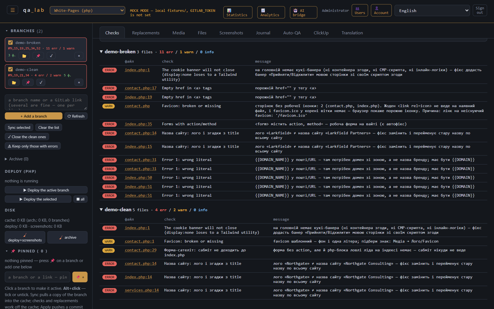
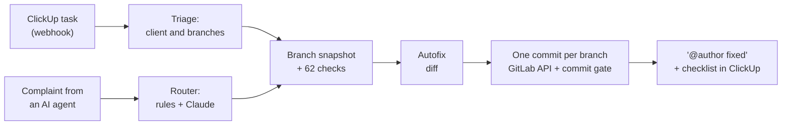
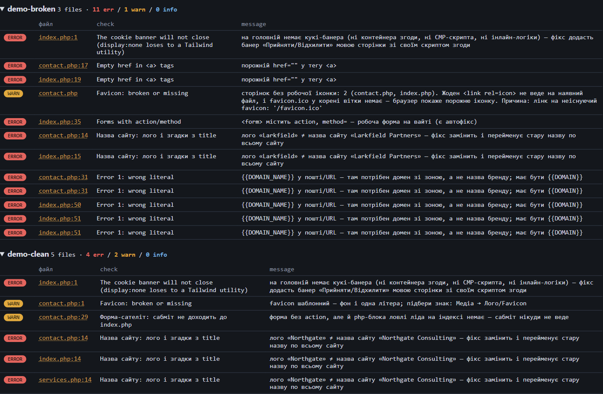
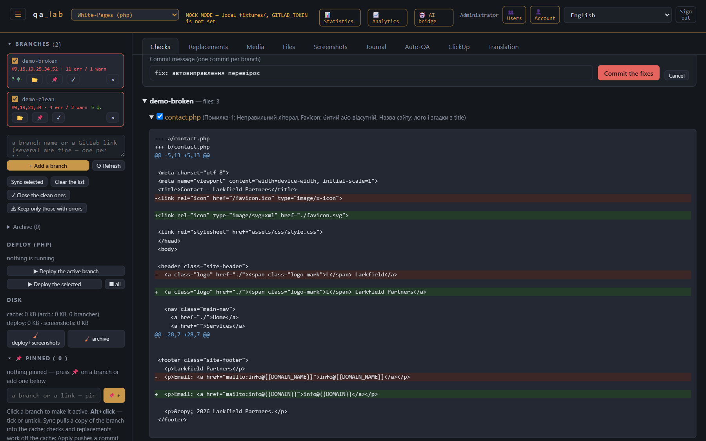
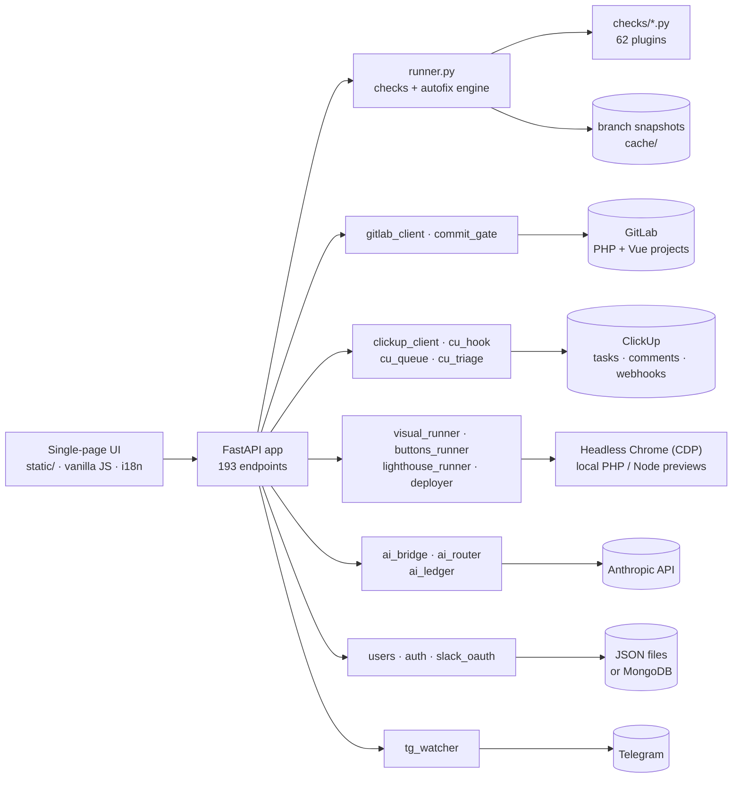

# qa_lab

**A QA and auto-fix platform for a fleet of small websites, each living in its own Git branch**

62 automated checks, 51 one-click autofixes, real-browser verification, ClickUp automation.



---

## What it is

The team maintains hundreds of small marketing websites, called *white pages* internally. Each site is a branch in a
GitLab repository: PHP/static sites live in one project, Vue/Nuxt/Next builds in another. QA engineers review the
live sites and file defects in ClickUp, for example:

- a form that goes nowhere;
- a cookie banner that won't close;
- an e-mail on the wrong domain;
- invisible text;
- a broken image.

**qa_lab** turns those reports into checks, fixes and commits:



## What it can do

| | |
|---|---|
| **62 automated checks** | Broken links and assets, forms that never submit, cookie banners that don't close, missing legal pages (Impressum, privacy policy), and contact blocks without a phone, e-mail or address. Also e-mails on a foreign domain, logo and site-name mismatches, broken favicons, template placeholders in visible text, wrong page language, suspicious prices and more. Covers PHP/HTML and Vue sites. |
| **51 one-click autofixes** | Every fix is shown as a diff first. Applying it makes **one commit per branch** through the GitLab API. A commit gate strips template tokens that would break the PHP deploy and warns about in-place edits of CDN-cached assets. Branches with broken code get no autofixes at all. |
| **Real-browser checks** | Pages are rendered in headless Chrome over the DevTools Protocol in two viewports, which catches low contrast, horizontal overflow, clipped text, empty blocks and broken images. Dead buttons are found by actually clicking them. Also: screenshots, Lighthouse audits and local PHP/Node preview deploys. |
| **ClickUp automation** | Imports QA tasks with their branches and comments. A webhook-driven queue, with background polling as a fallback, triages each task and pre-runs checks and fixes for a human to review. One click posts "@author fixed" with a real mention and ticks the task checklist. It also warns when a teammate has already replied "fixed". |
| **AI bridge** | An API for an external AI agent. A free-text complaint like "the logo looks wrong" is mapped to specific checks by keyword rules plus a Claude arbiter. The fixes and commits themselves stay deterministic. A monthly spend cap and loop protection keep two AIs from bouncing a task forever. |
| **Media tools** | Free stock-photo search with in-place image replacement, and a logo/favicon generator (shapes, palettes, initials, 790+ Lucide icons). File renames rewrite every reference in the same commit. |
| **Multi-user** | Signed-cookie sessions, an admin panel, per-user branch lists, "Sign in with Slack" (OpenID Connect) and Telegram digests of new tasks and mentions. The UI is in Ukrainian, with English and Russian translations. |
| **Offline demo mode** | Without a GitLab token the lab runs in **MOCK MODE**: branches are read from `fixtures/` and commits are written back there. Two demo sites are included. |

## Screenshots

<table>
<tr>
<td width="50%"><b>Findings</b>: every issue points to a file and line<br></td>
<td width="50%"><b>Autofix preview</b>: the diff before the commit<br></td>
</tr>
</table>

## Architecture



**A check is a single Python file.** Put it in `checks/` and it shows up in the UI.

```python
# checks/empty_href.py: the smallest check (shortened, messages translated)
import re

NAME = "Empty href in <a> tags"
GROUP = "tests"            # "auto" = has an autofix, "review" = applied by a human
PROJECTS = ["php"]
FILES = ["*.html", "*.php", "*.vue"]

RX = re.compile(r"<a\b[^>]*\bhref\s*=\s*([\"'])\s*\1", re.IGNORECASE)

def run(path, text):
    return [{"line": i, "severity": "error", "message": 'empty href="" in <a>'}
            for i, line in enumerate(text.splitlines(), 1) for _ in RX.finditer(line)]
```

Checks that need the whole site implement `run_branch(files, all_paths, branch)`. Checks that can repair it add
`fix_branch(...)`, which returns `edit` / `create` / `delete` actions. The runner merges every fix for a branch into one
commit.

## Quick start

Requirements:

- **Python 3.10+**. Tested on 3.10; the Docker image uses 3.12.
- Optional: Chrome or Edge for visual checks and screenshots, PHP for local preview deploys, Node.js for Lighthouse and
  the i18n engine tests.

```bash
git clone https://github.com/Q42fmr/qa_lab.git
cd qa_lab
python -m venv .venv
source .venv/bin/activate        # Windows: .venv\Scripts\activate
pip install -r requirements.txt

# offline demo: two sample sites instead of GitLab
mkdir -p fixtures && cp -r docker/seed-fixtures/demo-* fixtures/

ADMIN_LOGIN=demo ADMIN_PASSWORD=demo-pass-123 uvicorn app:app --port 8030
```

On Windows, run these commands in Git Bash. In PowerShell, set the two variables with `$env:NAME = "value"` instead.

Then:

1. Open <http://127.0.0.1:8030> and sign in as `demo` / `demo-pass-123`.
2. Switch the language to **English** in the header.
3. Press **Sync + checks**, then **Autofix** to see the diffs.

**Docker:**

```bash
cp .env.example .env     # set ADMIN_PASSWORD; leave GITLAB_TOKEN empty for the offline demo
docker compose -f docker-compose.dev.yml up --build
```

The dev stack also starts MongoDB for user accounts. The entrypoint seeds an empty `fixtures/` with the demo sites.

**Real integrations:** fill in `.env` for GitLab, ClickUp, Telegram, Slack, Anthropic and MongoDB. `.env.example`
documents every variable, and every integration is optional.

**Tests:** the project uses its own small harness instead of pytest; every `tests/test_*.py` is a plain script.

```bash
APP_DIR=. sh docker/run-tests.sh   # all suites + `import app`; needs Node.js; on Windows set PYTHONUTF8=1 first
```

## Project layout

```text
app.py               FastAPI app: API, auth, background jobs
runner.py            check discovery, runs, autofix → one commit per branch
checks/              62 check plugins (+ shared helpers, _parked/ experiments)
commit_gate.py       last line of defence before a commit reaches GitLab
gitlab_client.py     GitLab REST client: branch snapshots and commits
clickup_client.py    ClickUp tasks and comments, "@author fixed" + checklist
cu_hook.py           ClickUp webhook → cu_queue.py (auto-QA queue) → cu_triage.py
visual_runner.py     headless-Chrome visual checks (contrast, overflow, clipped text)
buttons_runner.py    dead-button detection by actually clicking
deployer.py          local PHP/Node preview deploys and screenshots
ai_bridge.py         API for an external AI agent; ai_router.py, ai_ledger.py, ai_skills*.py
brand_mark.py        logo/favicon generator; photos.py, media.py: media tools
static/              single-page UI (vanilla JS) with i18n
builder/             Next.js 15 master template for the site factory
docker/              Dockerfile, entrypoint, test gate, demo fixtures
tests/               135 suites, 2,389 test cases
```

## Tech stack

- **Backend:** Python, FastAPI, Uvicorn, requests, NumPy and Pillow (pixel analysis of screenshots).
- **Browser automation:** headless Chrome/Chromium driven over raw CDP (websockets), plus Lighthouse.
- **Frontend:** a vanilla JS single-page app with its own i18n layer. `builder/` holds a Next.js 15 / React 19 /
  TypeScript / Tailwind master template.
- **Integrations:**
  - GitLab REST API;
  - ClickUp API v2 with webhooks;
  - Anthropic Messages API;
  - Slack OpenID Connect;
  - Telegram Bot API.
- **Storage:** JSON state on disk; MongoDB is optional for users.
- **Ops:** Docker, Docker Swarm, Traefik and GitLab CI (test → build → deploy).

## About this repository

This is a sanitised copy of an internal tool:

- **Removed or replaced with synthetic data:** credentials, internal hosts, workspace identifiers, colleagues' names,
  client sites and real company records.
- **Not included:** the git history.

Most code comments are in Ukrainian. The UI has English and Russian translations, though some check descriptions are
still Ukrainian-only.

---

### Коротко українською

**qa_lab** — лабораторія QA для сотень невеликих сайтів, кожен з яких живе в окремій гілці GitLab.

- **Перевірки й автофікси.** 62 автоматичні перевірки, з них 51 з автофіксом. Спершу показується диф, потім робиться один коміт на гілку через GitLab API. Гейт коміту не пропускає токени, що зламали б деплой.
- **Браузер.** Headless Chrome рендерить сторінки у двох в'юпортах і ловить:
  - поганий контраст;
  - обрізаний текст;
  - биті картинки;
  - «мертві» кнопки.

  Також робить скріни, аудити Lighthouse і локальні PHP/Node-деплої.
- **ClickUp.** Черга авто-QA з вебхуків розбирає таску й заздалегідь проганяє чеки та фікси на рев'ю. Одна кнопка ставить «@автор fixed» і галочку в чеклісті.
- **Інше:**
  - ШІ-міст (правила + Claude підбирають перевірки під скаргу);
  - генератор лого й фавіконок;
  - пошук стокових фото;
  - офлайн-режим з демо-сайтами;
  - 2 389 тестів.
